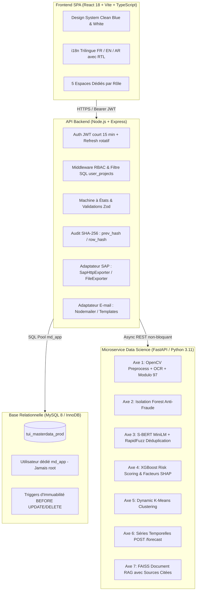

# Documentation Complète & Guide Technique — Master Data IA

> **Plateforme SaaS d'Entreprise de Gestion et de Sécurisation des Données Fournisseurs (P2P)**  
> **Cas d'usage de référence** : TUI Group Finance — Pôle Master Data Finance  
> **Conformité & Normes** : SOX (*Sarbanes-Oxley*), ISO 13616 (Modulo 97 SEPA), Sapin II, RGPD, SAP S/4HANA  

---

## Sommaire

1. [Vue d'Ensemble & Architecture Globale](#1-vue-densemble--architecture-globale)
2. [Modèle de Données & Schéma Relationnel](#2-modèle-de-données--schéma-relationnel)
3. [Le Moteur Data Science (Les 7 Axes IA)](#3-le-moteur-data-science-les-7-axes-ia)
4. [Guide Détaillé par Rôle Métier (Les 5 Acteurs)](#4-guide-détaillé-par-rôle-métier-les-5-acteurs)
   - [4.1. L'Administrateur Technique (`admin`)](#41-ladministrateur-technique-admin)
   - [4.2. Le Demandeur Achats (`requester`)](#42-le-demandeur-achats-requester)
   - [4.3. Le Fournisseur Externe (`vendor`)](#43-le-fournisseur-externe-vendor)
   - [4.4. L'Agent Opérationnel Master Data (`agent`)](#44-lagent-opérationnel-master-data-agent)
   - [4.5. Le Manager Approbateur Financier (`manager`)](#45-le-manager-approbateur-financier-manager)
5. [Cycle de Vie d'une Demande & Machine à États](#5-cycle-de-vie-dune-demande--machine-à-états)
6. [Guide de Démarrage & Déploiement Pas-à-Pas](#6-guide-de-démarrage--déploiement-pas-à-pas)
7. [Fonctionnement du Code & Mécanismes de Sécurité Clés](#7-fonctionnement-du-code--mécanismes-de-sécurité-clés)

---

## 1. Vue d'Ensemble & Architecture Globale

La plateforme **Master Data IA** digitalise et sécurise la chaîne d'entrée Procure-to-Pay (P2P) de TUI Group Finance : l'homologation de nouveaux tiers (*onboarding*) et la mise à jour critique de coordonnées bancaires (changement d'IBAN).

### Le Problème Métier Résolu
- **Risque FOVI / Fraude au RIB** : Altération d'IBAN vers des comptes frauduleux.
- **Erreurs manuelles de saisie** : ≈ 3,5 % d'erreurs humaines générant des rejets de virements bancaires coûteux.
- **Délais de traitement** : Passage d'une moyenne de 4,5 jours (par e-mails et formulaires papier) à un SLA cible inférieur à **48 heures**.
- **Auditabilité** : Obligation légale (SOX / Sapin II) de prouver qui a validé quel document, à quelle date, avec quelle adresse IP, sans aucune possibilité d'altération ultérieure.

### Architecture en 3 Tiers Découplés



---

## 2. Modèle de Données & Schéma Relationnel

La persistance repose sur **MySQL 8 (moteur InnoDB)** avec encodage `utf8mb4_unicode_ci`.

### Les 13 Tables Unifiées (Zéro Redondance)

1. **`users`** : Comptes nominatifs de tous les acteurs.
   - `id`, `email` (unique), `password_hash` (bcrypt/argon2), `full_name`, `role` (`admin`, `manager`, `agent`, `requester`, `vendor`), `status` (`invited`, `active`, `suspended`), `language` (`fr`, `en`, `ar`), `must_change_password`, `failed_attempts`, `locked_until`, `last_login_at`, `vendor_id` (nullable, lien vers la fiche du fournisseur pour le rôle vendor).
2. **`projects`** : Périmètres organisationnels configurables (aucun périmètre codé en dur).
   - `id`, `code` (unique, ex: `WESTERN`, `NORDIC`, `TGBST`), `name`, `description`, `is_active`, `currencies` (JSON : `["EUR", "GBP", "USD"]`), `created_by`, timestamps.
3. **`project_countries`** : Pays rattachés à chaque projet et règles documentaires.
   - `project_id`, `country_code` (ISO 3166-1 alpha-2, ex: `FR`, `SE`, `TN`), `required_documents` (JSON : `["RIB", "KBIS", "TAX_CERTIFICATE"]`).
4. **`user_projects`** : Table d'association assignant les acteurs internes à leurs projets autorisés.
   - `user_id`, `project_id`, `assigned_at`.
5. **`vendors`** : Référentiel maître des tiers **validés et certifiés** (synchronisés avec SAP).
   - `id`, `vendor_code` (ex: `VEND-001045`), `company_name`, `vat_number` (unique), `siret`, `address`, `country`, `iban`, `bic_swift`, `segment`, `project_id`, `status`.
6. **`vendor_requests`** : Dossiers de demandes (onboarding ou mise à jour).
   - `id`, `type` (`ONBOARDING`, `MODIFICATION`), `status` (`DRAFT`, `SUBMITTED`, `UNDER_REVIEW`, `VERIFIED_BY_AGENT`, `APPROVED`, `SYNCED`, `SYNC_FAILED`, `REJECTED`, `MISSING_INFORMATION`), `vendor_id`, `project_id`, `requester_id`, `assigned_agent_id`, `draft_data` (JSON), `extracted_ocr_data` (JSON), `ai_result` (JSON complet), `anomaly_score`, `risk_score` (DECIMAL 4,3), `recommendation`, `review_comment`, `submitted_at`, `decided_at`.
7. **`documents`** : Pièces justificatives téléversées et contrôlées.
   - `id`, `vendor_request_id`, `type` (`RIB`, `KBIS`, `TAX_CERTIFICATE`, `VAT_CERTIFICATE`, `OTHER`), `file_name`, `stored_name`, `file_path`, `mime_type`, `size`, `sha256`, `uploaded_by`, `uploaded_at`.
8. **`invitations`** : Jetons d'invitation uniques à durée limitée pour les fournisseurs.
   - `id`, `email`, `project_id`, `requester_id`, `token_hash`, `expires_at` (7 jours par défaut), `used_at`, `vendor_request_id`.
9. **`messages`** : Fil de discussion contextuel rattaché à chaque dossier.
   - `id`, `vendor_request_id`, `sender_id`, `body`, `created_at`, `read_at`.
10. **`notifications`** : Alertes temps réel pour chaque utilisateur.
    - `id`, `user_id`, `type`, `payload` (JSON), `read_at`, `created_at`.
11. **`audit_logs`** : Piste d'audit unique et inaltérable (actions administratives et métier fusionnées).
    - `id`, `vendor_request_id` (nullable), `actor_id`, `target_user_id` (nullable pour les actions sur les utilisateurs), `action`, `old_data` (JSON), `new_data` (JSON), `ip`, `user_agent`, `timestamp`, `prev_hash`, `row_hash`.
12. **`sap_sync_logs`** : Historique des tentatives de synchronisation ERP.
    - `id`, `vendor_request_id`, `attempt`, `status` (`SUCCESS`, `FAILURE`), `http_code`, `response` (JSON), `created_at`.
13. **`refresh_tokens`** : Gestion des sessions sécurisées avec révocation immédiate.
    - `id`, `user_id`, `token_hash`, `expires_at`, `revoked_at`, `created_at`.

---

## 3. Le Moteur Data Science (Les 7 Axes IA)

Le microservice FastAPI expose les 7 axes d'intelligence artificielle sous forme d'API REST découplée :

| Axe | Endpoint | Algorithme & Pipeline | Rôle Métier |
|:---:|---|---|---|
| **1** | `POST /extract` | Prétraitement OpenCV (filtre bilatéral, binarisation Sauvola, redressement Hough) + PaddleOCR / Tesseract + Regex NER + **Modulo 97 ISO 13616** | Extraction automatique des données du RIB / Kbis avec indice de confiance par champ. Si confiance < 0,75, alerte manuelle levée. |
| **2** | `POST /anomaly-score` | **Isolation Forest** (200 estimateurs, contamination 0.05) | Détection d'anomalies structurelles : incohérence pays IBAN vs siège social, modification soudaine après période d'inactivité, écart horaire. |
| **3** | `POST /match` | **Sentence-BERT multilingue MiniLM** (384 dim) + RapidFuzz token_sort_ratio avec cache Redis | Rapprochement sémantique et détection de doublons : score ≥ 0,85 (doublon hautement probable), 0,70-0,85 (arbitrage requis), < 0,70 (tiers inédit). |
| **4** | `POST /risk-scoring` | **XGBoost / HistGradientBoosting** (300 estimateurs) empilé sur l'Isolation Forest | Note de risque [0.000 à 1.000] avec liste ordonnée des **facteurs explicatifs** (SHAP-like : discordance pays, paradis fiscal, modification sensible). |
| **5** | `GET /segment` | **K-Means Clustering** (k = 4 clusters dynamiques) | Segmentation opérationnelle des tiers (Stratégique, Récurrent, Ponctuel, À surveiller) avec encodage dynamique des projets actifs. |
| **6** | `POST /forecast` | Décomposition additive temporelle (**SARIMA** / tendance + saisonnalité touristique) | Projection à 30/60/90 jours du volume entrant de dossiers, du délai moyen de traitement en jours et du risque de dépassement du SLA 48h. |
| **7** | `POST /rag-query` | Index vectoriel **FAISS** sur base documentaire interne TUI | Assistant conversationnel pour les équipes Finance, répondant avec citation stricte des politiques internes et guides de conformité. |

---

## 4. Guide Détaillé par Rôle Métier (Les 5 Acteurs)

Chaque personne dispose d'un **compte nominatif** et n'accède qu'à **son interface hermétique**.

```
┌────────────────────────────────────────────────────────────────────────┐
│                        ÉCRAN DE CONNEXION UNIQUE                       │
│  - E-mail professionnel + mot de passe individuel                      │
│  - Sélecteur de langue (Français / English / العربية avec RTL)         │
│  - Redirection automatique selon le rôle                               │
└───────────────────────────────────┬────────────────────────────────────┘
                                    │
       ┌──────────────┬─────────────┼──────────────┬──────────────┐
       ▼              ▼             ▼              ▼              ▼
   [ ADMIN ]     [ REQUESTER ]  [ VENDOR ]      [ AGENT ]    [ MANAGER ]
    Console       Portail        Portail         Contrôle     Gouvernance
   Technique     Demandes       Autonome       Opérationnel   & Décision
```

---

### 4.1. L'Administrateur Technique (`admin`)

L'administrateur gère l'infrastructure technique, les habilitations et les paramètres généraux. **Il ne prend aucune décision métier sur les dossiers.**

#### Fonctionnalités Principales :
1. **Gestion des Utilisateurs** :
   - Création de comptes internes (Manager, Agent, Requester, Admin).
   - Affectation du rôle et des projets autorisés (`user_projects`).
   - Suspension immédiate d'un compte ou réinitialisation forcée du mot de passe.
2. **Gestion des Projets Génériques** :
   - Création d'un projet avec son `code` (ex: `WESTERN`, `NORDIC`, `APAC`), son nom, et ses devises autorisées (`EUR`, `GBP`, `USD`, `TND`).
   - Sélection des **pays rattachés** (liste ISO 3166) et configuration des **pièces justificatives obligatoires** par pays.
   - Activation ou désactivation en un clic (un projet désactivé reste consultable en lecture seule pour l'historique légal).
3. **Paramétrage du Moteur IA (`ai_settings`)** :
   - Configuration des seuils opérationnels : seuil d'anomalie (défaut 0.60), seuil de matching doublons (0.85), confiance OCR minimale (0.75).
4. **Piste d'Audit Globale & Certification d'Intégrité** :
   - Consultation de tous les événements de la plateforme (actions admin et dossiers).
   - Bouton de **Vérification Cryptographique** (`GET /api/v1/admin/audit-logs/verify`) : recalcule toute la chaîne SHA-256 et certifie que l'historique n'a subi aucune altération malveillante.
   - Export au format CSV pour les auditeurs SOX.

---

### 4.2. Le Demandeur Achats (`requester`)

Le demandeur est un membre interne des équipes Achats ou Métiers de TUI Group qui souhaite référencer un nouveau prestataire ou mettre à jour un partenaire existant.

#### Fonctionnalités Principales :
1. **Tableau de Bord Personnel** :
   - Vision synthétique de ses demandes : En cours, Validées, Rejetées, Informations à compléter.
2. **Invitation d'un Fournisseur (Onboarding Déporté)** :
   - Saisie de l'e-mail du contact fournisseur et rattachement à un projet autorisé.
   - Génération d'un **lien d'invitation sécurisé à usage unique** (valable 7 jours).
   - Le fournisseur reçoit un e-mail officiel l'invitant à activer son espace.
3. **Création Directe d'une Demande Interne** :
   - Saisie des informations légales et bancaires avec **validation en direct de l'IBAN par Modulo 97**.
   - Détection instantanée d'incohérence si l'indicatif pays de l'IBAN ne correspond pas au pays du siège social.
4. **Suivi Temps Réel & Piste d'Avancement** :
   - Frise interactive montrant l'avancement : *Brouillon → Soumis → Contrôle Agent → Décision Manager → Injection SAP*.
   - Messagerie directe intégrée avec l'Agent Master Data pour répondre aux questions.
   - Export au format PDF de la fiche de synthèse certifiée dès l'approbation finale.

---

### 4.3. Le Fournisseur Externe (`vendor`)

Le fournisseur accède à un portail externe sécurisé et autonome. **Il ne voit jamais les scores IA internes ni les informations d'autres fournisseurs.**

#### Fonctionnalités Principales :
1. **Activation du Compte** :
   - Accès via le lien unique reçu par e-mail.
   - Définition de son mot de passe personnel respectant la politique de sécurité (8+ caractères, majuscule, chiffre, symbole).
2. **Assistant d'Onboarding en 4 Étapes** :
   - **Étape 1 : Identité de l'entreprise** : Dénomination légale, numéro de TVA intracommunautaire, SIRET/registre du commerce, adresse postale, pays.
   - **Étape 2 : Coordonnées bancaires** : Titulaire du compte, saisie assistée de l'IBAN avec vérification algorithmique instantanée (contrôle Modulo 97 ISO 13616), code BIC/SWIFT.
   - **Étape 3 : Dépôt des justificatifs** : Glisser-déposer des pièces exigées (RIB, extrait Kbis / Bolagsverket, attestation fiscale) avec contrôle immédiat de la taille (< 10 Mo) et du format (PDF, PNG, JPG).
   - **Étape 4 : Récapitulatif & Soumission** : Synthèse complète, engagement sur l'honneur et validation définitive.
3. **Sauvegarde de Brouillon (`DRAFT`)** :
   - Possibilité d'interrompre la saisie et de reprendre plus tard sans perte de données.
4. **Demande de Modification Post-Création** :
   - Si le fournisseur doit changer de coordonnées bancaires ultérieurement, il soumet une demande de modification (`MODIFICATION`) accompagnée obligatoirement d'un nouveau RIB.
5. **Gestion des Retours (`MISSING_INFORMATION`)** :
   - Si l'Agent demande une pièce complémentaire, le fournisseur reçoit une notification claire avec le motif précis et peut déposer le document manquant.

---

### 4.4. L'Agent Opérationnel Master Data (`agent`)

L'agent est le premier rempart humain du pôle Master Data Finance. Il contrôle l'exactitude des informations et certifie la conformité des pièces.

#### Fonctionnalités Principales :
1. **File d'Attente Priorisée** :
   - Liste des dossiers entrants appartenant à ses projets affectés.
   - Filtres par projet, statut, niveau de risque IA, et date de soumission.
2. **Fiche de Contrôle en Écran Divisé (*Split-Screen*)** :
   - **Volet gauche** : Visionneuse haute fidélité du document justificatif (zoom, rotation, téléchargement).
   - **Volet droit** : Tableau comparatif champ par champ :
     - *Données déclarées par le fournisseur*
     - *Données extraites par l'OCR (PaddleOCR / Tesseract)*
     - *Score de confiance IA par champ* (vert si > 0.85, orange si entre 0.75 et 0.85, rouge si < 0.75).
     - **Mise en évidence visuelle immédiate de tout écart**.
3. **Détection des Doublons Sémantiques** :
   - Affichage des tiers existants dans le catalogue SAP présentant une ressemblance orthographique (score cosinus Sentence-BERT + RapidFuzz).
   - Comparaison côte à côte pour éviter les doublons de création.
4. **Décisions Opérationnelles** :
   - **Transmettre au Manager (`VERIFIED_BY_AGENT`)** : Le dossier est complet et certifié conforme.
   - **Demander un complément (`MISSING_INFORMATION`)** : Avec **commentaire obligatoire** notifié au demandeur et au fournisseur.
   - **Rejeter le dossier (`REJECTED`)** : En cas de tentative avérée d'usurpation ou de non-conformité majeure, avec **motif obligatoire**.
   - *Règle stricte : L'Agent ne peut jamais valider définitivement vers SAP (monopole du Manager).*

---

### 4.5. Le Manager Approbateur Financier (`manager`)

Le responsable financier dispose d'une vue 360° sur le risque et la gouvernance. Il détient le pouvoir décisionnel final.

#### Fonctionnalités Principales :
1. **Tableau de Bord Exécutif & KPI** :
   - Taux d'approbation et de rejet par projet.
   - Délai moyen de traitement face au SLA cible de 48h.
   - Répartition des dossiers par niveau de risque (Faible, Modéré, Critique).
2. **File d'Arbitrage Triée par Risque** :
   - Les dossiers les plus sensibles sont automatiquement positionnés en tête de file.
   - Badges de recommandation IA :
     - 🟢 *Approbation standard recommandée* (score < 0.40, 100% conforme).
     - 🟡 *Contrôle approfondi requis* (score entre 0.40 et 0.70).
     - 🔴 *Alerte critique de fraude* (score ≥ 0.70, discordance de pays, IBAN suspect).
3. **Fiche d'Arbitrage 360° & Explicabilité SHAP** :
   - Jauge circulaire de risque global [0 à 100%].
   - **Facteurs explicatifs ordonnés** : Le manager comprend exactement pourquoi le score est élevé (ex : *+28% Discordance pays siège vs banque*, *+25% Compte récemment modifié*, *-15% Partenaire historique régulier*).
   - Historique complet des actions horodatées de la demande (*Audit Trail*).
4. **Décision Finale & Export ERP** :
   - **Approuver (`APPROVED`)** : Déclenche immédiatement l'export SAP via l'adaptateur `ErpExporter`.
     - Si le risque est supérieur à 70%, un blocage de paiement préventif `ZBLOCK` est automatiquement inclus dans le flux SAP.
   - **Rejeter (`REJECTED`)** : Clôture définitive du dossier avec motif obligatoire tracé dans l'audit SOX.
5. **Prévisions Temporelles de Volumétrie (Axe 6 Séries Temporelles)** :
   - Consomme l'endpoint IA `POST /api/v1/forecast`.
   - Graphique interactif projetant les flux entrants à 30, 60 et 90 jours pour dimensionner les équipes et anticiper les pics touristiques saisonniers.
6. **Assistant Réglementaire RAG (Axe 7)** :
   - Interface de dialogue en langage naturel avec la base documentaire TUI Finance (politiques de paiement, double signature, directives anti-blanchiment).
   - Chaque réponse cite précisément le document et l'article de référence.

---

## 5. Cycle de Vie d'une Demande & Machine à États

Le workflow applique une machine à états stricte, vérifiée au niveau du serveur :

```
                  ┌──────────────┐
                  │    DRAFT     │ (Brouillon sauvegardé)
                  └──────┬───────┘
                         │ Soumission complète
                         ▼
                  ┌──────────────┐
                  │  SUBMITTED   │ ──(Déclenchement asynchrone Pipeline IA)
                  └──────┬───────┘
                         │ Prise en charge Agent
                         ▼
                ┌──────────────────┐
        ┌───────┤   UNDER_REVIEW   ├────────┐
        │       └────────┬─────────┘        │
        │                │                  │
        │ Complément     │ Certification    │ Rejet direct
        │ requis         │ Agent            │ Agent
        ▼                ▼                  ▼
┌──────────────┐  ┌──────────────────┐  ┌──────────────┐
│   MISSING    │  │VERIFIED_BY_AGENT │  │   REJECTED   │
│ INFORMATION  │  └────────┬─────────┘  └──────────────┘
└───────┬──────┘           │                   ▲
        │ Fournisseur      │                   │ Rejet Manager
        │ re-soumet        │ Décision Finale   │ (motif obligatoire)
        └─────────────────►│ Manager           │
                           ▼                   │
                    ┌──────────────┐           │
                    │   APPROVED   │───────────┘
                    └──────┬───────┘
                           │ Export ERP (ErpExporter)
                           ▼
                    ┌──────────────┐
                    │    SYNCED    │ (Succès ACK SAP / Fichier écrit)
                    └──────────────┘
                           │
                           │ En cas d'échec de liaison ERP
                           ▼
                    ┌──────────────┐
                    │ SYNC_FAILED  │ (Bouton "Relancer l'export" disponible)
                    └──────────────┘
```

---

## 6. Guide de Démarrage & Déploiement Pas-à-Pas

### Prérequis Système
- **Node.js** : v20 ou v22 LTS (`node -v`)
- **Python** : 3.11 (`python --version`)
- **MySQL** : 8.x (ex: via le panneau de contrôle XAMPP, port 3306)

---

### Étape 1 : Préparation de la Base de Données

1. Démarrez le service MySQL depuis le panneau de contrôle XAMPP.
2. Créez la base de données de production et l'utilisateur applicatif dédié `md_app` :
   ```bash
   cd backend
   npm run db:create
   ```
3. Exécutez les migrations versionnées :
   ```bash
   npm run migrate
   ```
4. Initialisez le compte Administrateur de départ :
   ```bash
   npm run bootstrap:admin
   ```
   *Ce script lit `BOOTSTRAP_ADMIN_EMAIL` et `BOOTSTRAP_ADMIN_PASSWORD` dans votre `.env`, crée l'Admin et impose un changement de mot de passe à la première connexion.*

> **Rappel de Sécurité Absolu** : La base historique `masterdata_ia` ne sera jamais touchée. Si `DB_NAME=masterdata_ia`, les scripts s'interrompent immédiatement avec un message d'erreur bloquant.

---

### Étape 2 : Lancement des Services en Local (3 Terminaux)

#### Terminal 1 — Microservice IA FastAPI
```bash
cd ai-engine
python -m uvicorn app.main:app --host 0.0.0.0 --port 8000 --reload
```
- API & Documentation Swagger interactive : `http://localhost:8000/docs`
- Healthcheck : `http://localhost:8000/health`

#### Terminal 2 — API Backend Node.js / Express
```bash
cd backend
npm run dev
```
- Serveur API Express : `http://localhost:5000`
- Statut de santé : `http://localhost:5000/health`

#### Terminal 3 — Application Frontend React / Vite
```bash
cd frontend
npm run dev
```
- Interface Web : `http://localhost:5173`

---

### Étape 3 : Déploiement Conteneurisé avec Docker Compose

Pour un déploiement complet en un clic (incluant MySQL, Redis, Nginx avec reverse-proxy et les 3 services) :
```bash
docker compose up --build -d
```
Tous les conteneurs démarrent avec healthchecks automatiques.

---

## 7. Fonctionnement du Code & Mécanismes de Sécurité Clés

### 7.1. Le Garde-Fou Applicatif `assertSafeDatabaseTarget`
Dans [backend/src/config/db.js](file:///c:/Users/user/Downloads/tayma2/backend/src/config/db.js), une fonction normalise le nom de la base sans casse ni espaces :
```javascript
function assertSafeDatabaseTarget(dbName) {
  const normalized = (dbName || '').toLowerCase().replace(/[\s_\-]+/g, '');
  if (normalized.includes('masterdataia')) {
    console.error('⛔ ERREUR CRITIQUE DE SÉCURITÉ : Interdiction de cibler masterdata_ia !');
    process.exit(1);
  }
}
```

### 7.2. Chaînage Cryptographique de l'Audit SOX (SHA-256)
Chaque écriture dans `audit_logs` calcule une empreinte liée à la ligne précédente :
```javascript
const crypto = require('crypto');

function computeRowHash(prevHash, record) {
  const payload = [
    prevHash || '0000000000000000000000000000000000000000000000000000000000000000',
    record.actor_id,
    record.action,
    record.timestamp,
    JSON.stringify(record.old_data || {}),
    JSON.stringify(record.new_data || {})
  ].join('|');

  return crypto.createHash('sha256').update(payload).digest('hex');
}
```
Des **triggers MySQL** interdisent formellement toute modification :
```sql
CREATE TRIGGER audit_logs_prevent_update
BEFORE UPDATE ON audit_logs
FOR EACH ROW
BEGIN
  SIGNAL SQLSTATE '45000' SET MESSAGE_TEXT = 'La table audit_logs est en ajout seul (SOX Compliance).';
END;
```

### 7.3. Validation Modulo 97 ISO 13616 (Contrôle Clé IBAN)
L'algorithme nettoie l'IBAN, permute les 4 premiers caractères, remplace les lettres par leur valeur numérique ($A=10 \dots Z=35$), et applique le modulo 97 :
$$\text{IBAN\_Permuté} \pmod{97} \equiv 1$$
Ce contrôle est exécuté **en direct côté frontend** (frappe du demandeur ou fournisseur) ET **validé côté serveur** par le schéma Zod.

### 7.4. Adaptateur ERP SAP Configurable (`ErpExporter`)
Dans [backend/src/services/sapService.js](file:///c:/Users/user/Downloads/tayma2/backend/src/services/sapService.js), l'application bascule selon `SAP_EXPORTER_TYPE` :
- `file` : Génère un fichier d'échange horodaté prêt pour traitement IDoc dans `backend/exports/`.
- `http` : Envoie un appel POST certifié vers la passerelle SAP et enregistre l'accusé de réception (ACK) dans `sap_sync_logs`.
