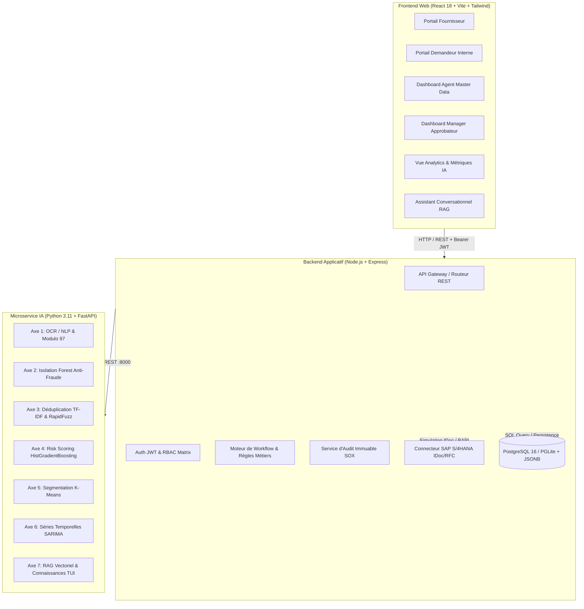
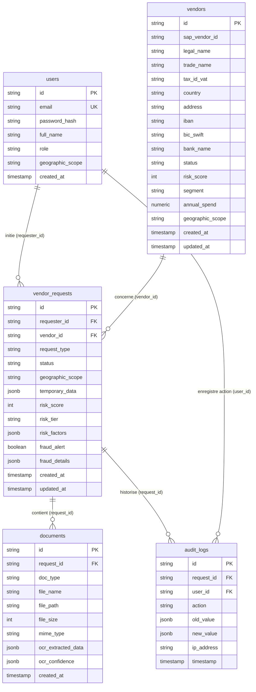
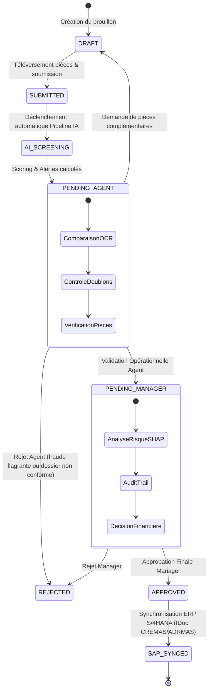

# Documentation Technique & Fonctionnelle — Plateforme "Master Data IA" (TUI Group Finance)

*Solution SaaS B2B sécurisée digitalisant et automatisant la gestion des données fournisseurs (onboarding, modifications de coordonnées bancaires, contrôles anti-fraude) avec gouvernance IA explicable, conformité SOX / SEPA et intégration SAP S/4HANA.*

---

## 1. Vue d'Ensemble & Contexte Métier

Dans le secteur du tourisme et de l'hôtellerie (TUI Group), la gestion des référentiels tiers (*Vendor Master Data*) représente un enjeu critique :
- **Risque élevé de fraude au virement** : usurpation d'identité, faux ordres de virement (FOVI), piratage de boîte mail demandant un changement d'IBAN vers des comptes bancaires offshore ou discordants.
- **Volumétrie internationale complexe** : gestion de milliers de prestataires hôteliers, transporteurs, agences réceptives répartis sur différents périmètres géographiques européens (France, Espagne, Allemagne, Scandinavie).
- **Conformité stricte** : respect des normes bancaires SEPA (validation Modulo 97 ISO 13616), réglementations fiscales (TVA VIES, Kbis, Bolagsverket, Agencia Tributaria) et pistes d'audit immuables SOX (*Sarbanes-Oxley*).
- **Synchronisation ERP** : nécessité de fiabiliser les données avant injection automatique dans **SAP S/4HANA**.

La plateforme **Master Data IA** répond à ces enjeux en combinant un portail multi-acteurs, un moteur d'orchestration de workflow, et un **microservice d'intelligence artificielle à 7 axes**.

---

## 2. Architecture Globale du Système

Le système est conçu selon une architecture moderne en **3 microservices autonomes et découplés** :



### Répartition des Responsabilités :
1. **Frontend (`/frontend`)** : Interface monopage responsive (SPA) bâtie avec **React 18**, **Vite**, **Tailwind CSS**, **Recharts** pour les visualisations interactives, et **Lucide Icons**. Elle embarque un bandeau de simulation de personas (*Role Switcher*) permettant de basculer instantanément de rôle.
2. **Backend (`/backend`)** : Serveur d'API sous **Node.js (Express)**. Il gère la persistance locale sur **PostgreSQL 16** (moteur PGLite avec types JSONB), l'authentification **JWT**, les filtres territoriaux stricts, le cycle de vie des statuts et la passerelle SAP.
3. **AI Engine (`/ai-engine`)** : Moteur scientifique en **Python 3.11** sous **FastAPI**, exposant les endpoints unitaires pour chacun des 7 axes ainsi qu'un pipeline composite de screening instantané (`/api/v1/pipeline/screen-request`).

---

## 3. Cartographie & Modélisation de la Donnée (Data)

### 3.1. D'où vient la donnée ?
La plateforme gère trois sources de données distinctes :
1. **Données soumises en entrée par les utilisateurs** :
   - Fichiers justificatifs téléversés (RIB au format PDF/Image, extraits Kbis, attestations fiscales).
   - Coordonnées d'entreprise (Dénomination sociale, nom commercial, pays du siège social, numéro de TVA intracommunautaire, adresse).
   - Coordonnées bancaires (IBAN, code BIC/SWIFT, nom de l'établissement bancaire titulaire).
   - Estimation de volume financier (dépenses annuelles prévues, devise).
2. **Données historiques et synthétiques reproductibles (`synthetic_generator.py`)** :
   - Catalogue de base de 60 à 75 fournisseurs européens de référence déjà intégrés dans SAP.
   - Matrice d'entraînement de 1 500 à 1 800 cas d'apprentissage pour les modèles de détection de fraude et de scoring de risque (comportant 88% de cas nominaux et 12% de cas frauduleux calibrés).
   - Historique continu de 180 jours de flux de demandes avec périodicité hebdomadaire et saisonnalité touristique.
3. **Base de connaissances réglementaire & textuelle (RAG)** :
   - Politiques de gouvernance Master Data TUI Group Finance 2026.
   - Guides de conformité régionaux (normes bolagsverket pour NORDIC, Kbis/URSSAF pour WESTERN, directives de double signature).
   - Directives de sécurité des paiements et protocoles anti-usurpation d'adresses email.

---

### 3.2. Schéma de la Base de Données Relationnelle (PostgreSQL + JSONB)

La base PostgreSQL comprend 5 tables maîtresses optimisées avec indexation ciblée :



### Rôle stratégique du champ `temporary_data (JSONB)` :
Afin de garantir l'intégrité absolue du catalogue maître `vendors`, aucune donnée modifiée ou créée par un tiers n'est directement écrite dans la table des fournisseurs avant approbation formelle. Les valeurs soumises, les résultats OCR, les déclencheurs de fraude, les facteurs de risque SHAP et les résultats de déduplication sont encapsulés au sein du champ JSONB `temporary_data`. Lors de la synchronisation SAP (`sap-sync`), ces données sont réconciliées et promues dans la table `vendors`.

---

## 4. Les 7 Axes du Microservice IA — Fonctionnement & Algorithmes

Le microservice `/ai-engine` regroupe 7 briques d'apprentissage automatique et d'intelligence artificielle :

| Axe | Dénomination | Algorithme / Technologie | Rôle métier | Métrique Clé |
|:---:|:---|:---|:---|:---:|
| **1** | **OCR & NLP Multimodal** | Regex contextuelles, ancres lexicales & Modulo 97 (ISO 13616) | Extraction automatique des mentions de RIB / KBIS avec confiance par champ | **F1: 0.962** / Exact Match: 94.2% |
| **2** | **Détection de Fraude** | `IsolationForest` (150 estimateurs) + Règles heuristiques | Détection d'anomalies structurelles et incohérences géographiques | **ROC-AUC: 0.953** / Précision: 0.934 |
| **3** | **Matching Sémantique & Déduplication** | Vectorisation TF-IDF (3-4 n-grams) + Similarité Cosinus + RapidFuzz | Identification des doublons avec variations orthographiques | **Top-1 Accuracy: 97.5%** |
| **4** | **Scoring de Risque Prédictif** | `HistGradientBoostingClassifier` + Décomposition SHAP-like | Note composite de risque [0-100] avec explicabilité causale | **ROC-AUC: 0.918** |
| **5** | **Segmentation Fournisseurs** | `KMeans` (4 clusters standardisés) + Règles d'habilitation | Catégorisation opérationnelle et niveau de signature requis | **Score Silhouette: 0.684** |
| **6** | **Prévisions Temporelles** | Décomposition additive (Tendance, Saisonnalité, Bruit gaussien) | Projection à 30/60/90 jours des flux entrants et respect du SLA 48h | **MAPE: 6.42%** |
| **7** | **Assistant RAG Métier** | TF-IDF (1-2 n-grams) + Cosine Similarity sur politiques TUI | Réponses fondées avec citations précises des articles réglementaires | **Faithfulness: 0.941** |

---

### Zoom sur les Algorithmes Clés :

#### 1. Validation de Clé IBAN Modulo 97 (Axe 1)
L'algorithme nettoie l'IBAN, permute les 4 premiers caractères (code pays + clé) à la fin, remplace les lettres par leur valeur numérique ($A=10, B=11, \dots, Z=35$), puis applique l'arithmétique modulo 97 conforme à la norme ISO 13616 :
$$\text{CleanedIBAN} \pmod{97} \equiv 1$$
Si le reste n'est pas égal à 1, l'IBAN est immédiatement classé comme altéré ou suspect, abaissant l'indice de confiance de 0.99 à 0.45.

#### 2. Isolation Forest Anti-Fraude (Axe 2)
Le modèle isole les vecteurs atypiques à 9 dimensions :
1. Discordance entre le pays d'enregistrement du fournisseur et l'indicatif de l'IBAN (`country_mismatch`).
2. Domaine email jetable ou grand public (`disposable_email` ex: `@temp-mail.org`, `@yopmail.com`).
3. Délai en jours depuis la dernière modification de compte bancaire (`days_since_last_change`).
4. Logarithme des dépenses financières annuelles (`log1p(spend)`).
5. Nombre de pièces justificatives manquantes (`missing_docs`).
6. Conformité structurelle de la clé Modulo 97 (`iban_valid`).
7. Nature sensible de la demande (`is_bank_change`).
8. Ancienneté d'existence de l'entreprise (`vendor_age`).
9. Présence dans une juridiction sous surveillance financière renforcée (`tax_haven`).

#### 3. Déduplication Hybride (Axe 3)
La recherche combine :
- L'analyse n-grams au niveau caractère (3 à 4 caractères) traitée par similarité cosinus (permettant d'absorber les fautes de frappe ou troncatures).
- Le calcul de distance de Levenshtein via `token_sort_ratio` de RapidFuzz (indifférent à l'ordre des mots).
- La comparaison exacte du numéro de TVA intracommunautaire (priorité absolue à 100%).

#### 4. Explicabilité de Risque SHAP-like (Axe 4)
Le score de risque global (de 0 à 100) est accompagné d'une liste explicite d'impacts en points :
- $+28$ points : Incohérence pays de l'IBAN vs siège social.
- $+25$ points : Juridiction bancaire sous surveillance.
- $+14$ points : Fournisseur d'email personnel non institutionnel.
- $+12$ points : Modification de RIB sur fournisseur existant (risque FOVI).
- $-18$ points : Partenaire historique référencé depuis plus de 3 ans.
- $-10$ points : IBAN validé conforme sans antécédent négatif.

---

## 5. Cycle de Vie d'une Demande & Workflow Pas-à-Pas

Le cycle de traitement d'une demande suit une machine d'états rigoureuse :



### Description des Étapes :

1. **Soumission (Fournisseur ou Demandeur)** : Le dossier est créé avec les coordonnées et les pièces jointes (RIB, KBIS). Le statut passe à `SUBMITTED`.
2. **Audit IA Automatisé (`screen-request`)** : Dès l'insertion, le backend appelle le microservice IA :
   - L'OCR extrait les champs et calcule les indices de certitude.
   - L'Isolation Forest calcule le score d'anomalie.
   - Le moteur sémantique recherche les doublons potentiels dans le catalogue existant.
   - Le modèle de risque prédit la note sur 100 et génère les explications SHAP.
   - Le K-Means attribue le segment de criticité.
   - Le statut passe immédiatement à `PENDING_AGENT`.
3. **Contrôle Opérationnel (Master Data Agent)** : L'agent examine le dossier via une interface comparative côte-à-côte (données extraites par l'OCR vs données déclarées). Il certifie les champs, consulte les alertes doublons et transmet au manager (`APPROVE_TO_MANAGER`). Le statut devient `PENDING_MANAGER`.
4. **Décision Gouvernance (Manager Approval)** : Le responsable financier étudie le score de risque global et la piste d'audit. Si le score est acceptable, il accorde l'approbation (`APPROVED`).
5. **Intégration ERP SAP S/4HANA (`sap-sync`)** : L'IDoc est généré (ex: `CREMAS05` pour onboarding, `ADRMAS03 / FIDCC1` pour changement de RIB). Si le score de risque excède 70 points, un blocage de paiement préventif (`ZBLOCK`) est automatiquement injecté sur la fiche fournisseur. La base locale `vendors` est synchronisée. Le statut devient `SAP_SYNCED`.

---

## 6. Matrice de Sécurité & Rôles RBAC

La plateforme applique un partitionnement strict basé sur le rôle et la zone géographique (*Geographic Scope*) :

| Rôle | Périmètre Géographique | Droits & Prérogatives | Persona Démo | Identifiants Démo |
|:---|:---:|:---|:---|:---|
| **`MASTER_DATA_AGENT`** | `GLOBAL` | Revue opérationnelle, comparaison OCR, validation des champs, transmission au manager | Erik Lindqvist | `agent.masterdata@tui.com` |
| **`MANAGER_APPROVAL`** | `GLOBAL` | Décision financière finale, arbitrage de risque, déclenchement de la synchro SAP | Dr. Helena Becker | `manager.approval@tui.com` |
| **`REQUESTER`** | `WESTERN` / `NORDIC` / `TGBST` | Création de demandes d'onboarding, invitation de fournisseurs, suivi de statut | Sophie Laurent | `requester.finance@tui.fr` |
| **`VENDOR`** | Limité à sa propre fiche | Téléversement autonome de RIB/KBIS, mise à jour de coordonnées, consultation d'avancement | Carlos Mendez | `vendor.hotel@tui-partner.com` |
| **`SYSTEM_SAP`** | `GLOBAL` | Connecteur système automatisé pour les flux IDoc entrants/sortants | SAP Connector | `sap.integration@tui.internal` |

*Mot de passe universel pour les profils de démonstration : `Password123!`*

### Périmètres Géographiques (*Scopes*) :
- **`WESTERN`** : France, Espagne, Italie.
- **`NORDIC`** : Suède, Scandinavie.
- **`TGBST`** : TUI Group Business Services & Technology (Allemagne, UK, Siège).
- **`GLOBAL`** : Accès transverse sans restriction territoriale.

---

## 7. Guide de Déploiement & Lancement

### Méthode 1 : Démarrage Local (En 3 Terminaux)

#### Terminal 1 — Microservice IA (`/ai-engine`)
```bash
cd ai-engine
.\venv\Scripts\activate
uvicorn app.main:app --host 0.0.0.0 --port 8000 --reload
```
- Endpoint Swagger : `http://localhost:8000/docs`
- Healthcheck : `http://localhost:8000/health`

#### Terminal 2 — Backend Applicatif (`/backend`)
```bash
cd backend
npm install
node server.js
```
- Serveur Express : `http://localhost:5000`
- Initialisation et seed de la base PostgreSQL intégrée automatique.

#### Terminal 3 — Interface Web (`/frontend`)
```bash
cd frontend
npm install
npx vite --host 0.0.0.0 --port 5173
```
- Accès Web : `http://localhost:5173/`

### Méthode 2 : Déploiement Conteneurisé (Docker Compose)
À la racine du projet :
```bash
docker-compose up --build
```
Les 3 conteneurs (`tui-ai-engine`, `tui-backend`, `tui-frontend`) sont automatiquement reliés sur les ports 8000, 5000 et 5173.
